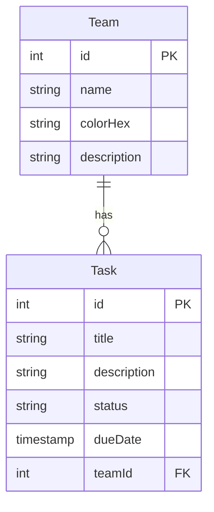
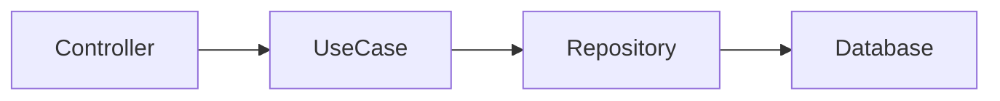
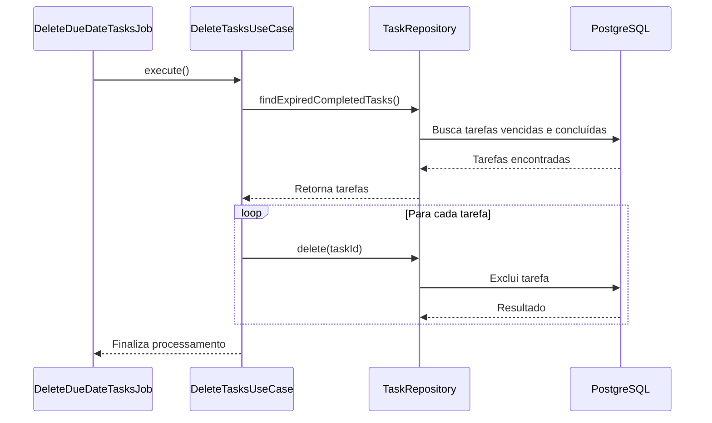

# Perguntas e respostas — Decisões arquiteturais

### 1. Por que escolhi o PostgreSQL?

Escolhi o PostgreSQL por ser um banco de dados relacional e atender bem às necessidades da aplicação.

Como temos entidades com relacionamentos bem definidos, como `Team` e `Task`, acredito que um banco relacional seja a melhor opção para esse cenário. Além disso, o PostgreSQL oferece recursos importantes, como transações, constraints e integridade referencial, ajudando a manter a consistência dos dados.

Outro ponto que considerei foi sua maturidade, o fato de ser open source e possuir uma comunidade bastante ativa.

### 2. Como modelei o banco de dados e os relacionamentos?

A modelagem foi feita considerando as entidades e as regras de negócio da aplicação.

Temos duas entidades principais: `Team` e `Task`. Um time pode possuir várias tarefas, mas cada tarefa pertence a apenas um time. Por isso, utilizei um relacionamento de um-para-muitos (1:N), mantendo a referência do time através do campo `teamId` na entidade `Task`.

Também considerei a obrigatoriedade dos campos de acordo com sua finalidade. Um exemplo é o `dueDate`, que é opcional, permitindo que uma tarefa seja criada sem uma data de vencimento.

A integridade do relacionamento é mantida através de uma chave estrangeira, evitando que uma tarefa seja associada a um time inexistente.

### 3. Como organizei as camadas do projeto?

Organizei o projeto em módulos, separando as funcionalidades de `Team` e `Task`. Dessa forma, cada módulo concentra suas próprias responsabilidades.

Dentro dos módulos, separei o código nas seguintes camadas:

- **Controllers:** responsáveis por receber as requisições HTTP e retornar as respostas.
- **Use Cases:** concentram os fluxos de aplicação e as regras necessárias para executar cada operação.
- **Entities:** representam as entidades e os conceitos do domínio.
- **Repositories:** responsáveis pela comunicação com o banco de dados.

A ideia dessa organização é evitar que as regras de negócio fiquem acopladas aos detalhes de infraestrutura, facilitando a manutenção e os testes.

Também procurei manter as responsabilidades bem definidas, para que uma alteração na persistência, por exemplo, não exija mudanças desnecessárias nos casos de uso.

## Modelo de dados



## Fluxo da aplicação



## Job para exclusão de tarefas

A aplicação possui um job responsável por verificar e excluir tarefas que já passaram da data de vencimento e estão com o status `concluído`.

A execução é feita de forma agendada, sem depender de uma requisição HTTP. O job aciona o caso de uso responsável pela operação, que consulta as tarefas que atendem aos critérios definidos e solicita sua exclusão através do repositório.



---

# Como rodar o projeto?

1. Clone o repositório.
2. Instale as dependências:

```bash
npm install
```

3. Crie um arquivo `.env` na raiz do projeto. Utilize o `.env.example` como referência para configurar as variáveis necessárias.
4. Inicie o banco de dados e os serviços definidos no Docker Compose:

```bash
cd backend
docker compose up -d
```

5. Execute as migrations a partir da pasta `backend`:

```bash
npm run migration:run
```

As migrations também inserem dados iniciais para avaliação: 3 times e 10 tarefas.
Para executar esse carregamento explicitamente, use:

```bash
npm run seed
```

6. Inicie a aplicação:

```bash
npm run start
```

Após iniciar a aplicação, a documentação da API estará disponível através da rota `/docs`.

---

# Exemplos de requisições

Os exemplos abaixo demonstram como utilizar os principais endpoints da aplicação.

## Team

### Create Team

```bash
curl -X POST \
  'http://localhost:3001/api/teams' \
  -H 'Content-Type: application/json' \
  -d '{
    "name": "Agile Team",
    "colorHex": "#FF5733",
    "description": "A description of the team"
  }'
```

### Get All Teams

```bash
curl -X GET \
  'http://localhost:3001/api/teams?limit=100&offset=0'
```

### Get Team by ID

```bash
curl -X GET \
  'http://localhost:3001/api/teams/{teamId}'
```

### Update Team

```bash
curl -X PUT \
  'http://localhost:3001/api/teams/{teamId}' \
  -H 'Content-Type: application/json' \
  -d '{
    "name": "Updated Team Name",
    "colorHex": "#33FF57",
    "description": "Updated description of the team"
  }'
```

### Delete Team

```bash
curl -X DELETE \
  'http://localhost:3001/api/teams/{teamId}'
```

## Task

### Create Task

```bash
curl -X POST \
  'http://localhost:3001/api/tasks' \
  -H 'Content-Type: application/json' \
  -d '{
    "title": "Implement authentication",
    "description": "Implement authentication module",
    "status": "pronta para desenvolvimento",
    "dueDate": "2026-10-31T14:23:03.118Z",
    "teamId": "{teamId}"
  }'
```

### Get All Tasks

```bash
curl -X GET \
  'http://localhost:3001/api/tasks?teamId={teamId}&limit=100&offset=0&status=em%20progresso'
```

### Get Task by ID

```bash
curl -X GET \
  'http://localhost:3001/api/tasks/{taskId}'
```

### Update Task

```bash
curl -X PUT \
  'http://localhost:3001/api/tasks/{taskId}' \
  -H 'Content-Type: application/json' \
  -d '{
    "title": "Implement authentication",
    "description": "Updated task description",
    "status": "pendente",
    "dueDate": "2026-10-31T14:24:28.493Z"
  }'
```

### Delete Task

```bash
curl -X DELETE \
  'http://localhost:3001/api/tasks/{taskId}'
```

---

# O que eu faria diferente em produção?

A implementação atual atende ao que foi proposto no desafio. Porém, pensando em um ambiente de produção, existem alguns pontos que eu melhoraria.

**Autenticação e autorização:** implementaria autenticação para proteger os endpoints e autorização para controlar quais operações cada usuário poderia realizar. Também avaliaria a integração com algum provedor de identidade, dependendo da estrutura da empresa.

**Logs e monitoramento:** adicionaria logs estruturados e métricas para acompanhar o comportamento da aplicação. Também configuraria alertas para identificar problemas como aumento de erros, lentidão nas requisições e falhas no processamento dos jobs.

**Banco de dados:** utilizaria um serviço gerenciado, como Amazon RDS, para facilitar a administração do PostgreSQL. Também configuraria backups e uma estratégia de recuperação em caso de falhas. A necessidade de alta disponibilidade seria avaliada de acordo com os requisitos do sistema.

**Idempotência:** nas operações que podem ser repetidas, principalmente em cenários de retry, implementaria mecanismos para evitar efeitos duplicados. Para operações de criação, por exemplo, poderia utilizar uma chave de idempotência associada ao resultado da primeira requisição, além de constraints no banco quando necessário.

**Cache:** avaliaria a utilização de Redis caso identificasse consultas frequentes que justificassem o armazenamento temporário dos resultados. Também seria necessário definir uma estratégia de expiração e invalidação para evitar informações desatualizadas.

**Auditoria:** adicionaria registros das operações realizadas, identificando quem executou a ação, qual recurso foi alterado e quando ocorreu. Isso ajudaria na investigação de problemas e no rastreamento de alterações.

**Job de exclusão:** em produção, avaliaria executar esse processamento fora da aplicação principal, utilizando uma solução como AWS Lambda com agendamento pelo EventBridge. A escolha dependeria do volume de tarefas e da frequência de execução. Também consideraria processamento em lotes e tratamento de falhas para evitar que uma execução interrompida comprometesse todo o processamento.

**Alertas:** configuraria alertas baseados nas métricas e nos logs da aplicação, principalmente para identificar falhas, aumento de latência e problemas de disponibilidade.

Essas melhorias seriam implementadas conforme a necessidade do negócio e os requisitos do ambiente produtivo, evitando adicionar complexidade antes que ela seja realmente necessária.
